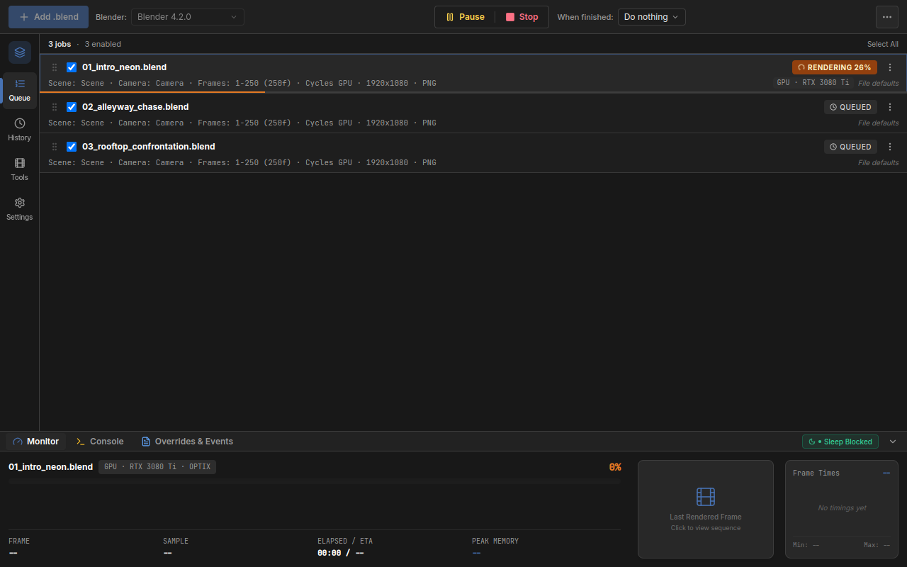
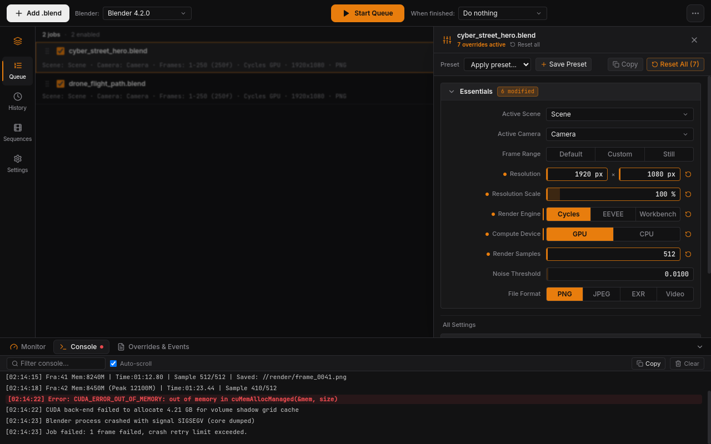
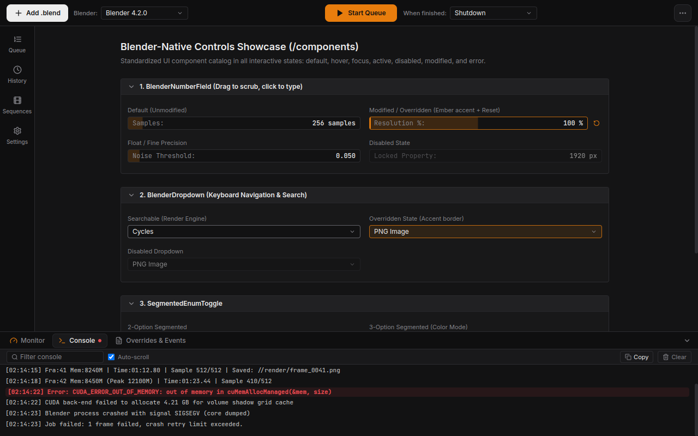

# Render Night

> A high-performance local render queue desktop app for Blender with a Blender-native look, realtime sequence player, and headless CLI. Built in pure Rust with BUI (`blenderui`).

Render Night enables seamless background batch rendering for Blender. It operates strictly headlessly—it **never** opens Blender's graphical interface to inspect or render, and **NEVER** modifies or saves your `.blend` files. All scene overrides, cameras, and device configurations are applied strictly in-memory during execution.

---

## Interface Overview


*Active batch render queue showing master-detail layout, device badges, real-time monitor dock, and frame sparkline.*

| Slide-Over Job Settings Drawer | Interactive Components Showcase |
| :---: | :---: |
|  |  |
| *Slide-over settings drawer with Essentials upfront and advanced RNA tree* | *Custom drag-to-scrub number fields, dropdowns, and toggles* |

---

## Key Features

- **Blender Discovery & Version Switching:**
  - Auto-discovers Blender installations across Windows, macOS, Linux, Steam, Flatpak, Snap, and custom locations.
  - Supports switching versions per queue or globally; locate custom binaries via native file picker (`rfd`).
- **Headless In-Memory Inspection & RNA Diff Overrides:**
  - Zero-GUI inspection extracting scenes, cameras, RNA metadata, and compute devices without modifying `.blend` files.
  - Schema-driven property drawer with 30+ high-value pinned controls (Cycles, EEVEE, EEVEE-Next, Workbench).
  - Engine-aware property tree hiding irrelevant controls.
  - Copy and paste overrides across jobs with automatic engine compatibility validation and Skip Report dialogs.
- **Production Presets:**
  - Built-in presets: *Draft Cycles*, *Final Quality Cycles*, *EEVEE Fast Preview*, *Print 300 DPI*.
  - Save, export, import, and apply custom RNA override presets as JSON.
- **Frame Range Parser & Image vs. Video Rule:**
  - Modes: *Scene Default*, *Simple* (start/end/step), *Custom*, and *Single Still*.
  - Custom multi-range parser: e.g. `50-200, 200-300`, `1-50, 75, 120-240x2` with deduplication and sorting.
  - **Rule**: Discontinuous multi-ranges are allowed for image formats. Video formats (FFmpeg, AVI) strictly require continuous sequential frames.
  - *Render Missing Frames Only*: Scans the target folder and skips already-rendered frames.
- **Crash Recovery & Resilience:**
  - When Blender crashes (e.g., CUDA/OptiX out of memory), Render Night automatically relaunches Blender afresh, reloads the file, retries the failed frame, optionally falls back to CPU, and isolates failed frames without aborting the queue.
  - Configurable retry limits and consecutive crash thresholds.
  - Resilient session restore via `unclean-shutdown.lock` and resume-after-crash dialog.
- **Pre-flight Validation & Quick Fixes:**
  - Pre-render validation detecting missing textures/assets, unwritable paths, low disk space, missing cameras, newer file versions, and video range violations.
  - One-click quick fixes (e.g., switch to continuous range, switch compute device to CPU).
  - Configurable pre-flight modes: *Never Block*, *Ask with Countdown (30s)*, or *Strict*.
- **Realtime Image Sequence Player (Pure Rust):**
  - High-performance playback engine driven by a monotonic clock (`frame = start + floor(((now - t0)/1000) * fps * speed)`), never a timer-per-frame.
  - Off-thread threadpool decoding supporting PNG, JPEG (`zune-jpeg`), and OpenEXR (`exr`) with bilinear downscaling at decode when source > display.
  - Memory-budgeted LRU RAM cache (configurable budget, default min 4 GB / 40% free RAM) and adaptive read-ahead ring buffer (~2.0s lookahead, nearest-neighbor outward spiral during scrubbing).
  - Realtime (drop frames to maintain temporal sync) vs. Every-frame playback toggle.
  - Transport & shuttle controls (`J`/`K`/`L` for 1x, 2x, 4x, 8x), speed multipliers, loop toggle, and In/Out markers (`I`, `O`, `Alt+X`).
  - Automated Intra-frame H.264 (GOP 1) video proxy fallback with sRGB tone-mapping when drop rate exceeds 5% or for heavy 32-bit EXR/HDR footage.
  - Live folder watching (`notify`) extending the timeline as active renders output new frames.
  - Zoom & pan (`F` to fit, `1` for 100%), checkerboard alpha background, and Performance HUD overlay (`S`).
- **Safe Post-Queue Actions:**
  - Selectable actions: *Do Nothing*, *Sleep*, *Hibernate*, *Shutdown*, *Restart*, *Close App*.
  - **Hard Safety Rule**: Followed by a visible 60-second cancel countdown modal with disarm on any keystroke. Restored sessions strictly disarm post-actions.
- **Audio Feedback:**
  - Signature synthesized "to-DUNG" chime via `rodio` upon completion. Background playback works reliably across all platforms.
- **History View:**
  - Search, filter by status, reveal in native file manager, and re-add completed jobs to the queue.
  - Append-only JSONL history logging with automatic rotation at 1,000 entries.

---

## Headless CLI (`render-night`)

Render Night includes a zero-GUI standalone CLI compiled from `crates/rn-cli`:

```bash
# Run a render queue definition file
render-night --queue queue.json [options]

# Inspect a .blend file and emit RNA metadata JSON
render-night inspect scene.blend [--blender <path|version|latest>]

# List discovered local Blender installations
render-night list-blenders
```

### CLI Options

- `--queue <path>`: Path to queue JSON file to execute.
- `--blender <spec>`: Specify executable path, version (e.g. `4.2`), or `latest`.
- `--post-action <none|sleep|hibernate|shutdown|restart|close_app>`: Safe power action after graceful completion.
- `--resume`: Scan output directory and resume unfinished queue from missing frames.
- `--preset <name>`: Apply a preset to all jobs in the queue.
- `--dry-run`: Run preflight checks and print terminal summary without launching Blender.

Exit codes: `0` (Success), `1` (Render failed / error), `2` (Bad command line arguments).

---

## Blender Version Support

Render Night supports:
- **Blender 4.2 LTS** and **4.x / 5.x** (including new `BLENDER_EEVEE_NEXT` architecture).
- **Blender 3.6 LTS** through **3.0** (with legacy `BLENDER_EEVEE` engine support).
- Automatic forward and backward version compatibility checks with non-blocking warnings when files were saved in newer versions than the selected executable.

---

## Installation & Distribution Packages

Automated release packages are built for Windows, Linux, and macOS:

| OS | Distribution Format | Architecture | Notes |
|:---|:---|:---|:---|
| **Windows** | NSIS Installer (`.exe`) | `x64` | Standard Windows setup wizard installing Desktop and Start Menu shortcuts. |
| **Windows** | Portable (`.zip`) | `x64` | Standalone portable bundle containing both `render-night-gui.exe` and `render-night.exe`. |
| **Linux** | AppImage (`.AppImage`) | `x86_64` | Standalone self-contained executable (`chmod +x`). |
| **Linux** | Debian (`.deb`) | `amd64` | System package registering `render-night` and desktop entry under `Graphics`. |
| **macOS** | DMG Disk Image (`.dmg`) | `arm64` (Apple Silicon) / `x64` (Intel) | Self-contained `.app` bundle with drag-to-Applications installer. |

### macOS Experimental Notes & Gatekeeper Notice

Pre-built macOS binaries are signed ad-hoc. On first launch:
1. Double-click the downloaded `.dmg` and drag `Render Night.app` into `Applications`.
2. **Right-click** (or Control-click) `Render Night.app` in `/Applications` and select **Open**.
3. In the Gatekeeper security dialog, click **Open**.
4. Subsequent launches can be performed directly from Spotlight or Launchpad.

---

## Development & Building from Source

Render Night is written in pure Rust (2021 edition) and uses Cargo workspaces.

### Prerequisites

- **Rust toolchain:** 1.80+ (`rustup default stable`)
- **Linux dependencies:**
  ```bash
  sudo apt-get install -y libx11-dev libgl1-mesa-dev libxext-dev libxcursor-dev libxinerama-dev libxi-dev libxrandr-dev libasound2-dev
  ```
- **macOS / Windows:** No external C library dependencies required (bundled in toolchain).

### Build Commands

```bash
# Check compilation across all workspace crates
cargo check --workspace

# Run all 98 unit, integration, golden, and property tests
cargo test --workspace

# Check formatting and clippy lints
cargo fmt --check
cargo clippy --all-targets -- -D warnings

# Build release binaries
cargo build --release --bin render-night --bin render-night-gui

# Run interactive desktop GUI
cargo run --bin render-night-gui

# Run headless CLI
cargo run --bin render-night -- list-blenders
```

---

## License

Render Night is licensed under the [GNU General Public License v3.0 or later (GPL-3.0-or-later)](LICENSE).
Third-party component licensing terms (Blender and FFmpeg) are documented in [`docs/LICENSES.md`](docs/LICENSES.md).
