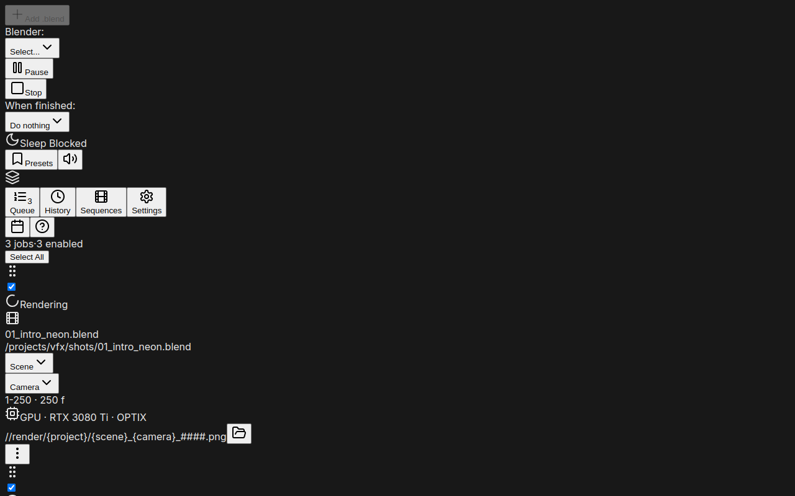
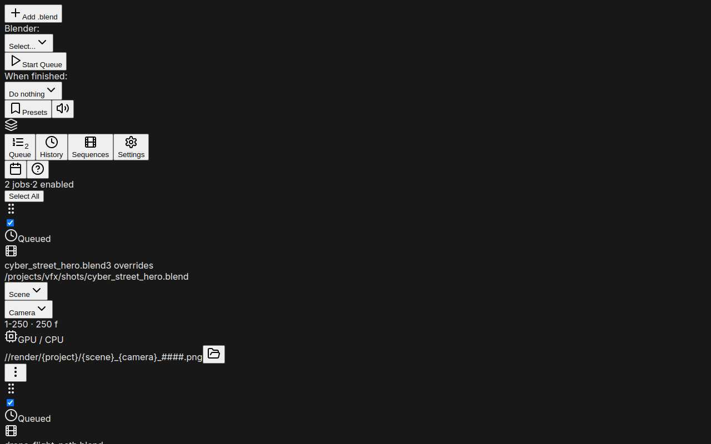
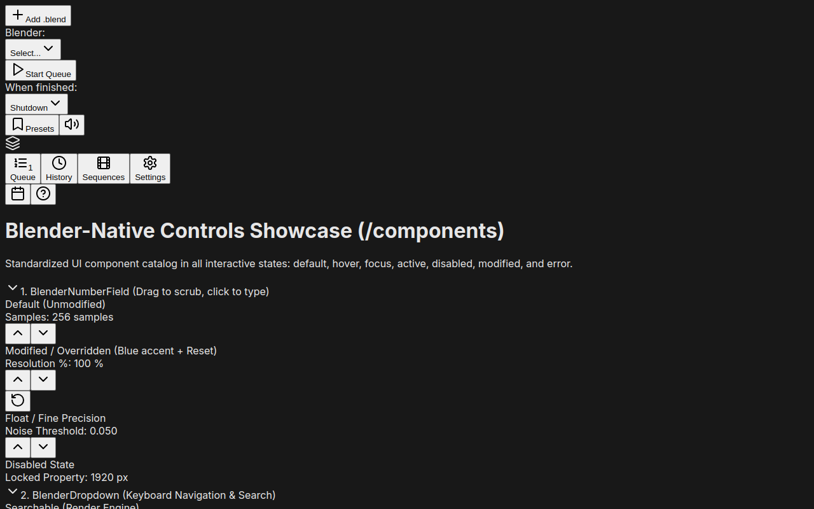

# Render Night

> A fast local render queue desktop app for Blender with a Blender-native look and headless CLI.

Render Night enables seamless background batch rendering for Blender. It operates strictly headlessly—it **never** opens Blender's graphical interface to inspect or render, and **NEVER** modifies or saves your `.blend` files. All scene overrides, cameras, and device configurations are applied strictly in-memory during execution.

---

## Interface Overview


*Active batch render queue showing master-detail layout, device badges, real-time monitor dock, and frame sparkline.*

| Blender-Style Properties Panel | Interactive Components Showcase |
| :---: | :---: |
|  |  |
| *Blender-native properties editor with vertical icon tab strip* | *Custom drag-to-scrub number fields, dropdowns, and toggles* |

---

## Key Features

- **Blender Discovery & Version Switching:**
  - Auto-discovers Blender installations across Windows, macOS, Linux, Steam, Flatpak, Snap, and custom locations.
  - Supports switching versions per queue or globally.
- **Headless In-Memory Inspection & RNA Diff Overrides:**
  - Zero-GUI inspection extracting scenes, cameras, RNA metadata, and compute devices without modifying `.blend` files.
  - Schema-driven property drawer with 30+ high-value pinned controls (Cycles, EEVEE, EEVEE-Next, Workbench).
  - Engine-aware property tree hiding irrelevant controls.
  - Copy and paste overrides across jobs with automatic compatibility validation.
- **Production Presets:**
  - Built-in presets: *Draft Cycles*, *Final Quality Cycles*, *EEVEE Fast Preview*, *Print 300 DPI*.
  - Save, export, import, and apply custom RNA override presets.
- **Frame Range Parser & Image vs. Video Rule:**
  - Modes: *Scene Default*, *Simple* (start/end/step), *Custom*, and *Single Still*.
  - Custom multi-range parser: e.g. `50-200, 200-300`, `1-50, 75, 120-240x2` with deduplication and sorting.
  - **Rule**: Discontinuous multi-ranges are allowed for image formats. Video formats (FFmpeg, AVI) strictly require continuous sequential frames.
  - *Render Missing Frames Only*: Scans the target folder and skips already-rendered frames.
- **Crash Recovery & Resilience:**
  - When Blender crashes (e.g., CUDA/OptiX out of memory), Render Night automatically relaunches Blender afresh, reloads the file, retries the failed frame, optionally falls back to CPU, and isolates failed frames without aborting the queue.
  - Configurable retry limits and consecutive crash thresholds.
- **Pre-flight Validation & Quick Fixes:**
  - Pre-render validation detecting missing textures/assets, unwritable paths, low disk space, missing cameras, newer file versions, and video range violations.
  - One-click quick fixes (e.g., switch to continuous range, switch compute device to CPU).
- **Image Sequence Tools:**
  - Dedicated viewer tab: detect frame sequences, scrub timeline at custom fps, preview missing frame gaps.
  - Converter & stitcher: transcode image sequences to MP4 (H.264/H.265), WebM, or ProRes with resolution, quality, and audio muxing.
  - *Stitch to MP4 when finished* post-render job option.
- **Headless CLI (`night-render`):**
  - Zero Electron dependencies; pure Node engine sharing `src/core`.
  - Full parity: runs pre-flight checks, crash recovery, sleep blocker, and safe post-actions.
  - Progress line, terminal bell (`\x07`), and strict exit codes (`0` ok, `1` failed, `2` bad input).
- **Safe Post-Queue Actions:**
  - Selectable actions: *Do Nothing*, *Sleep*, *Hibernate*, *Shutdown*, *Restart*, *Close Night Render*.
  - **Hard Safety Rule**: Only executes after a live session completes gracefully, followed by a visible 60-second cancel countdown. Crashes, force-closes, or restored sessions never trigger power actions.
- **Audio Feedback:**
  - Signature synthesized "to-DUNG" sound on completion. Background throttling disabled so sound plays even when minimized.
- **One-Shot Overnight Scheduling:**
  - Schedule queue execution at a specific time with sleep prevention while waiting.

---

## Blender Version Support

Render Night supports:
- **Blender 4.2 LTS** and **4.x / 5.x** (including new `BLENDER_EEVEE_NEXT` architecture).
- **Blender 3.6 LTS** (with legacy `BLENDER_EEVEE` engine support).
- Backward and forward compatibility checks with warnings when files were saved in newer versions than the selected executable.

---

## Installation & Distribution Packages

Releases are built for Windows, macOS, and Linux:

| OS | Distribution Format | Architecture | Notes |
|:---|:---|:---|:---|
| **Windows** | NSIS Installer (`.exe`) | `x64` | Standard installer; runs as non-admin (`asInvoker`). |
| **Windows** | Portable (`.exe`) | `x64` | Standalone portable executable. |
| **macOS** | DMG (`.dmg`) | `arm64` (Apple Silicon) + `x64` (Intel) | Drag-and-drop `.app` bundle. |
| **Linux** | AppImage (`.AppImage`) | `x64` | Standalone executable (`chmod +x`). |
| **Linux** | Debian (`.deb`) | `x64` | Installs system desktop entry under `Graphics`. |

### macOS Unsigned Alpha Notice (Gatekeeper Workaround)

Render Night alpha builds are currently unsigned. When opening for the first time on macOS:
1. Locate `Render Night.app` in `/Applications` using Finder.
2. **Right-click** (or Control-click) the application and select **Open**.
3. In the security confirmation dialog, click **Open**.
4. Subsequent launches can be performed normally from Spotlight or Launchpad without prompts.

---

## Headless CLI (`night-render`)

Render Night includes a bundled headless CLI tool:

```bash
# Run a render queue definition file
night-render --queue queue.json [options]

# Inspect a .blend file and print RNA metadata JSON
night-render inspect <file.blend> [--blender <path|version|latest>]

# List discovered local Blender installations
night-render list-blenders
```

### CLI Options

- `--blender <spec>`: Specify executable path, version (e.g. `4.2`), or `latest`.
- `--post-action <none|sleep|hibernate|shutdown|restart|close_app>`: OS action after graceful completion.
- `--resume`: Scan destination folder and resume unfinished queue from missing frames.
- `--preset <name>`: Apply a preset to all jobs in the queue.
- `--dry-run`: Run preflight checks and print queue preview without rendering.

For full CLI documentation and `queue.json` schema details, see [`docs/cli.md`](docs/cli.md).

---

## Development

```bash
# Install dependencies
npm ci

# Launch desktop app in development mode
npm run dev

# Run CLI directly via tsx
npm run cli -- list-blenders

# Run tests
npm test

# Run linter and typechecker
npm run lint
npm run typecheck

# Build release bundle
npm run build
npm run dist:linux   # Linux AppImage + deb
npm run dist:win     # Windows NSIS + Portable
npm run dist:mac     # macOS DMG (arm64 + x64)
```

---

## License

- Render Night is licensed under the [MIT License](LICENSE).
- FFmpeg and Blender licensing terms are documented in [`docs/LICENSES.md`](docs/LICENSES.md).
